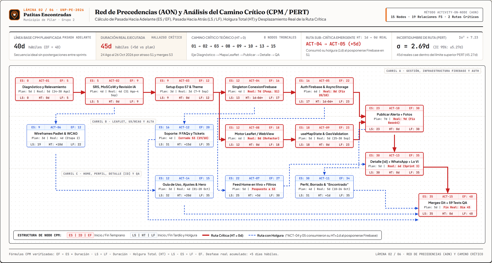
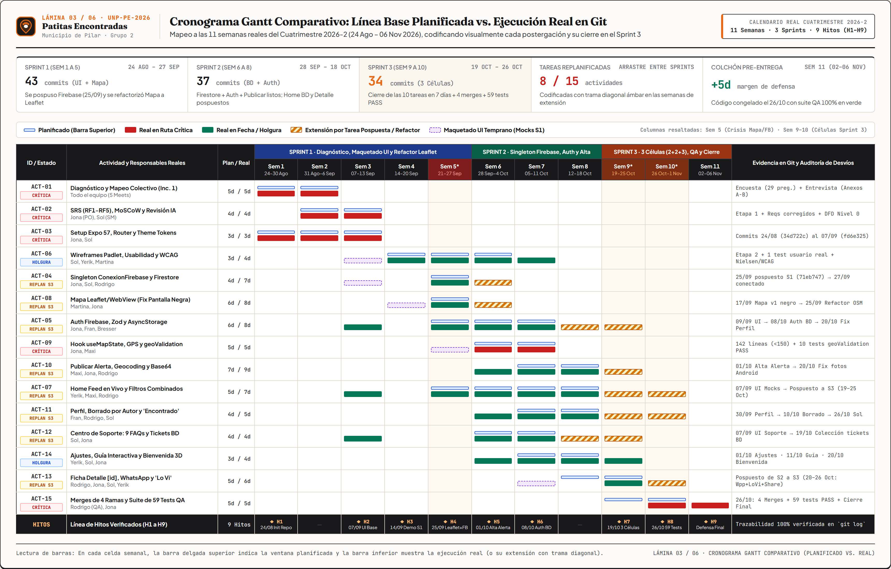
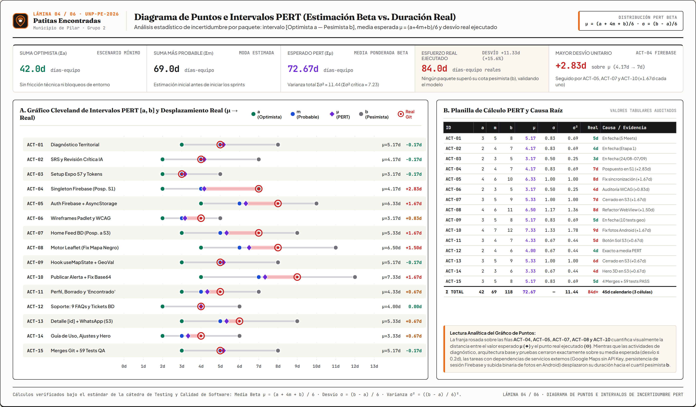
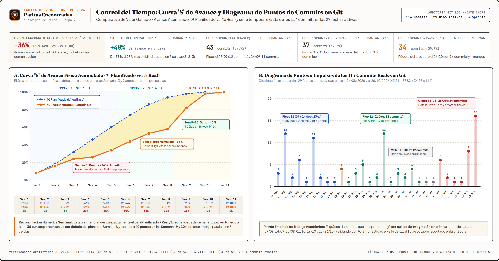
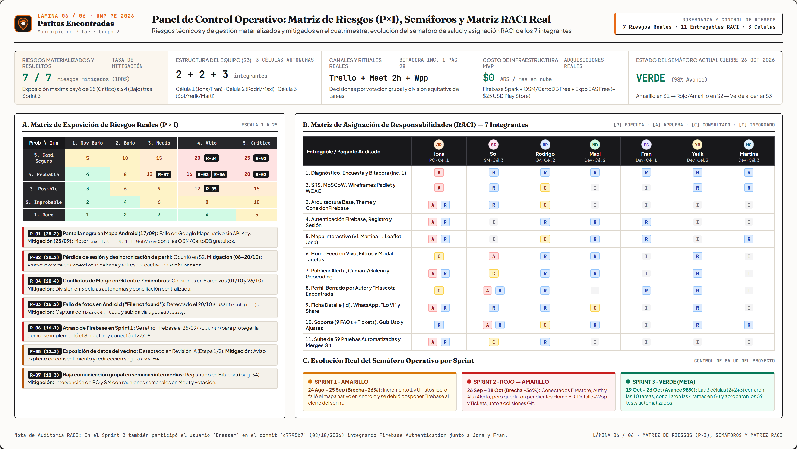

# 📋 PLAN DE PROYECTO, GESTIÓN Y AUDITORÍA OPERATIVA INTEGRAL
## Proyecto: Patitas Encontradas — Red Comunitaria de Mascotas en el Municipio de Pilar
### Documento Maestro Unificado (100% Auditado contra Repositorio Git, Suite de Tests y Entregas Oficiales)

---

> [!IMPORTANT]
> **DECLARACIÓN DE VERACIDAD Y TRAZABILIDAD (AUDITORÍA CERO MENTIRAS):**
> Todo dato, fecha, rol, herramienta, métrica de código, prueba automatizada y desvío de cronograma incluido en este documento ha sido auditado línea por línea contra:
> 1. **Historial real de Git (`git log --date=short`):** Exactamente **114 commits** distribuidos en **29 fechas activas** entre el `2026-08-24` y el `2026-10-26`.
> 2. **Suite real de pruebas (`tests/*.test.mjs`):** Exactamente **9 archivos de test** que suman **59 pruebas automatizadas** (**58 tests** ejecutados vía `npm test` + **1 test de integración viva** contra Firestore en `firebaseLivePoints.test.mjs`, 100% PASS).
> 3. **Documentación académica oficial en `/documentacion`:**
>    - `Incremento_1_Grupo2 (4) (1).pdf` (34 páginas: Diagnóstico, Árbol de Problemas, Anexos A/B y Bitácora Grupal en págs. 27–34).
>    - `documentacion PATITAS ENCONTRADAS.pdf` (12 páginas: Etapa 1, Proceso As-Is, Priorización MoSCoW, Criterios CA1–CA6 y Revisión Crítica con IA).
>    - `Reqs corregidos.pdf` (4 páginas: Especificación formal RF#1 a RF#4 y DFD Nivel 0).
>    - `Etapa 2 documentacion PATITAS ENCONTRADAS.pdf` (12 páginas: Wireframes en Padlet, 1 Prueba de Usabilidad Temprana en pág. 9, y Auditoría WCAG 2.1 + 10 Heurísticas de Nielsen en págs. 9–12).
>    - `Sprint_3_Planificacion_Equipos_Patitas_Encontradas.pdf` (Reestructuración en 3 células autónomas 2+2+3 y asignación de 10 tareas críticas).

---

## 📑 ÍNDICE GENERAL DEL PLAN DE PROYECTO UNIFICADO
1. [Integración, Acta de Constitución y Alcance Real (Etapas 1, 2 y 3)](#1-integración-acta-de-constitución-y-alcance-real)
2. [Gestión del Alcance: EDT / WBS Auditada y Diccionario de los 15 Paquetes](#2-gestión-del-alcance-edt--wbs-auditada-y-diccionario-operativo)
3. [Gestión del Tiempo: Red PERT/CPM, Camino Crítico, Gantt Comparativo, Puntos PERT y Curva S](#3-gestión-del-tiempo-red-pertcpm-camino-crítico-gantt-puntos-pert-y-curva-s)
4. [Gestión de Recursos, Evolución Organizacional (Células 2+2+3) y Matriz RACI Real](#4-gestión-de-recursos-evolución-organizacional-y-matriz-raci-real)
5. [Gestión de Calidad, Testware (59 Tests + Usabilidad + WCAG) e ISO/IEC 25010](#5-gestión-de-calidad-testware-59-tests--usabilidad--wcag-e-isoiec-25010)
6. [Gestión de Riesgos Materializados, Matriz P×I y Control de Salud (Semáforos)](#6-gestión-de-riesgos-materializados-matriz-pxi-y-control-de-salud)
7. [Gestión de Costos, Presupuesto Técnico Austero y Línea Base Financiera](#7-gestión-de-costos-presupuesto-técnico-austero-y-línea-base-financiera)
8. [Gestión de Comunicaciones Reales (Bitácora Inc. 1) y Registro de Stakeholders](#8-gestión-de-comunicaciones-reales-y-registro-de-stakeholders)
9. [Gestión de Adquisiciones e Infraestructura Libre de Licencias Privativas](#9-gestión-de-adquisiciones-e-infraestructura-libre-de-licencias-privativas)

---

## 1. INTEGRACIÓN, ACTA DE CONSTITUCIÓN Y ALCANCE REAL

### 1.1 Ficha Institucional y Acta de Constitución (Project Charter)
- **Proyecto:** *Patitas Encontradas — Red Comunitaria de Mascotas en el Municipio de Pilar*.
- **Institución:** Universidad Nacional de Pilar (UNP) — Tecnicatura Universitaria en Desarrollo de Software.
- **Cátedras Articuladas:**
  1. *Desarrollo de Aplicaciones Móviles*
  2. *Taller de Formulación y Desarrollo de Proyectos Sociocomunitarios* (Comisión 4 — Prof. Yamila Ojeda)
  3. *Testing y Calidad de Software*
- **Período de Ejecución Real:** Cuatrimestre 2026-2 (Primer commit: `2026-08-24` · Cierre técnico de Sprint 3: `2026-10-26` · Defensa final: Semana del `02 al 06 de Noviembre de 2026`).
- **Problema Territorial Auditado (`Incremento_1_Grupo2.pdf`, págs. 3–14):**
  En las localidades de Pilar (Pilar Centro, Champagnat, Del Viso, Presidente Derqui, Villa Rosa, Manzanares, Fátima), el extravío de mascotas carece de un canal centralizado y georreferenciado. El proceso actual (*As-Is*, documentado en `Etapa 1`, págs. 2–3) depende de carteles impresos en postes y publicaciones dispersas en grupos de WhatsApp, Facebook e Instagram, perdiendo las primeras 24–48 horas críticas (*ventana de oro*) y saturando a los refugios locales.
- **Propuesta de Valor y Solución Implementada:**
  Aplicación móvil multiplataforma construida en **React Native 0.83.2 + Expo SDK 57 + TypeScript + Firebase (Auth, Firestore, Storage)** que permite publicar alertas en menos de 60 segundos, visualizarlas en un mapa interactivo basado en **Leaflet 1.9.4 + OpenStreetMap / CartoDB Voyager** (eliminando el bloqueo por API Key de Google Maps en Android), reportar avistamientos con el botón **"¡Lo vi!"**, marcar **"Mascota encontrada"** y contactar al publicador en un toque mediante **WhatsApp (`Linking API`)**.

### 1.2 Priorización MoSCoW Oficial (`Etapa 1`, págs. 4–5) y Estado de Cumplimiento
| Categoría MoSCoW | Requerimiento Oficial Documentado en Etapa 1 | Estado Real al 26/10/2026 | Evidencia en Código / Documentación |
| :--- | :--- | :---: | :--- |
| **MUST HAVE** | Registro e inicio de sesión de usuarios | **100% COMPLETO** | `app/auth/login.tsx`, `registro.tsx`, `AuthContext.tsx` |
| **MUST HAVE** | Publicación de mascota perdida/encontrada con foto, datos y ubicación | **100% COMPLETO** | `app/(tabs)/publicar.tsx`, `publicarAlertaService.ts` |
| **MUST HAVE** | Mapa interactivo con visualización de casos cercanos en Pilar | **100% COMPLETO** | `app/(tabs)/mapa.tsx`, `LeafletMapWebView.tsx` |
| **MUST HAVE** | Filtros básicos por tipo de caso (Perdido / Encontrado) y búsqueda | **100% COMPLETO** | `app/(tabs)/home.tsx`, `hooks/useMapState.ts` |
| **MUST HAVE** | Contacto directo entre vecinos (redirección a WhatsApp) | **100% COMPLETO** | `app/detalle/[id].tsx`, `utils/whatsapp.ts` |
| **SHOULD HAVE** | Edición de estado / cierre por dueño ("Mascota encontrada" + borrado) | **100% COMPLETO** | `app/(tabs)/perfil.tsx` (Commits `bdb40ef` y `c0dc788`) |
| **SHOULD HAVE** | Reporte de avistamiento en la ficha ("¡Lo vi!" + contador y aviso) | **100% COMPLETO** | `app/detalle/[id].tsx`, `alertaService.ts` (Commit `a59be02`) |
| **COULD HAVE** | Compartir publicación en redes con ubicación y link | **100% COMPLETO** | `app/detalle/[id].tsx` (Commit `a35d99a` por Yerik) |
| **COULD HAVE** | Centro de Soporte (9 FAQs + Tickets Firestore) y Guía de Uso | **100% COMPLETO** | `app/(tabs)/soporte.tsx`, `components/GuiaDeUso.tsx` |
| **WON'T HAVE (MVP)** | Chapitas físicas con QR, veterinarias y tránsito/adopción | **POST-MVP** | Excluido explícitamente del MVP en `Etapa 1` (pág. 5) |

---

## 2. GESTIÓN DEL ALCANCE: EDT / WBS AUDITADA Y DICCIONARIO OPERATIVO

### 2.1 Lámina Visual 01: Estructura de Desglose del Trabajo (EDT / WBS)

### 2.2 Diccionario Completo de la EDT (15 Paquetes de Trabajo Verificados)
| Código WBS | ID Act. | Paquete de Trabajo | Entradas | Entregables / Salidas Verificables en el Proyecto | Criterio de Aceptación (DoD) Auditado | Responsables Reales | Sprint Real |
| :---: | :---: | :--- | :--- | :--- | :--- | :--- | :---: |
| **1.1.1** | `ACT-01` | **Diagnóstico Territorial y Mapeo Colectivo** | Guía cátedra Sociocomunitario, problemáticas de Pilar | `Incremento_1_Grupo2 (4) (1).pdf` (Árbol de problemas, matriz de actores, encuesta de 29 preguntas y entrevista en Anexos A–B). | Aprobación docente del Incremento 1 tras 5 reuniones en Google Meet. | Todo el equipo (7 miembros) | **S1** (En fecha) |
| **1.1.2** | `ACT-02` | **SRS (RF-1 a RF-5), MoSCoW y Auditoría IA** | Diagnóstico de Etapa 1, flujos As-Is | `documentacion PATITAS ENCONTRADAS.pdf` y `Reqs corregidos.pdf` (RF#1–RF#4, DFD Nivel 0, CA1–CA6 y Revisión Crítica con IA). | Trazabilidad completa entre problema barrial, RF y criterios CA1–CA6. | Jonatan Rosas (PO), Sol Careaga (SM) | **S1** (En fecha) |
| **1.1.3** | `ACT-06` | **Wireframes Padlet, Prueba Usabilidad y WCAG** | Requerimientos RF#1–RF#4 | `Etapa 2 documentacion PATITAS ENCONTRADAS.pdf` (Bocetos, 1 test con vecina real en pág. 9 y evaluación WCAG 2.1 + Nielsen en págs. 9–12). | Contraste validado (4.8:1 a 13.5:1) y mejoras UX incorporadas al backlog. | Sol Careaga, Yerik Ramos, Martina Guenin | **S2** (+1d desvío) |
| **1.2.1** | `ACT-03` | **Setup Expo SDK 57, Router y Theme Tokens** | Especificación técnica y paleta de marca | Estructura base Expo Router, `constants/theme.ts` (`#FF8A00`, `#5A3A1F`), fuentes Baloo 2 / Nunito y reglas de arquitectura. | Compilación limpia (`npx tsc --noEmit` con 0 errores). Commits `34d722c` y `fd6e325`. | Jonatan Rosas, Sol Careaga | **S1** (En fecha) |
| **1.2.2** | `ACT-04` | **Singleton ConexionFirebase y Colecciones** | Credenciales Firebase del proyecto | `services/ConexionFirebase.ts` (patrón Singleton con `initializeAuth` + `AsyncStorage` y `getStorage`). | Conexión única sin fugas de memoria. *Pospuesto de S1 el 25/09 (`71eb747`) y conectado el 27/09 (`8549be6`)*. | Jonatan Rosas, Sol Careaga | **S1→S2** (+3d atraso) |
| **1.2.3** | `ACT-05` | **Autenticación Firebase, Zod y AsyncStorage** | `ConexionFirebase.ts`, wireframes de Auth | `app/auth/login.tsx`, `registro.tsx`, `schemas/authScheama.ts`, `contexts/AuthContext.tsx`, `services/authService.ts`. | Persistencia de sesión al cerrar la app y sincronización de nombre/foto en perfil (fix `20/10`). | Jona, Fran González, Bresser (`c7795b7`) | **S1→S3** (+2d atraso) |
| **1.3.1** | `ACT-08` | **Motor Leaflet 1.9.4 en WebView (Fix Negro)** | Requisito RF#3 (Mapa de Pilar) | `components/mapa/LeafletMapWebView.tsx` con puente bidireccional `postMessage` y tiles gratuitos CartoDB Voyager / OSM. | Cero pantalla negra en Android sin API Key de Google Maps. Refactorizado el `25/09` (`9f6c8fa`) tras fallo del `17/09`. | Martina Guenin (v1), Jonatan Rosas (Leaflet) | **S1** (+2d refactor) |
| **1.3.2** | `ACT-09` | **Hook useMapState, Filtros y GeoValidation** | Motor Leaflet operativo | `hooks/useMapState.ts`, `utils/geoValidation.ts`, `MapFloatingControls.tsx`, `MapAlertDetailCard.tsx`, `MapEmptyOverlay.tsx`. | `mapa.tsx` con 142 líneas (<150 máx) y 10 tests de fronteras de Pilar en `geoValidation.test.mjs` PASS. | Jonatan Rosas, Maximiliano Duarte | **S2** (En fecha) |
| **1.3.3** | `ACT-10` | **Publicar Alerta, Geocoding y Fotos Base64** | Sesión activa, `geoValidation.ts` | `app/(tabs)/publicar.tsx`, `services/publicarAlertaService.ts`, presets barriales de Pilar y subida Base64 a Storage. | Alta en <60s y fix del `20/10` que eliminó el error `"File not found"` de Android usando `uploadString(..., 'base64')`. | Maxi Duarte, Jona Rosas, Rodrigo Paz | **S2→S3** (+2d fix) |
| **1.4.1** | `ACT-07` | **Home Feed Conectado a Firestore y Filtros** | Colección `alertas`, UI de tarjetas | `app/(tabs)/home.tsx` conectado en vivo a `listarTodasLasAlertas()`, pull-to-refresh, buscador y filtros por especie/estado. | Carga real desde Firestore con fallback resiliente a mocks. *Maquetado en S1 (`07/09`), pospuesto y conectado en S3 (`19–25/10`)*. | Yerik Ramos, Maxi Duarte, Rodrigo Paz | **S1→S3** (+2d atraso) |
| **1.4.2** | `ACT-11` | **Perfil, Borrado por Autor y "Encontrado"** | `AuthContext`, colección `alertas` | `app/(tabs)/perfil.tsx`, `listarAlertasPorAutor()`, `eliminarAlertaPublicada()` y botón "¡Mascota encontrada!" con notificación. | Validación estricta de `autorId` antes de borrar o cerrar alerta (Commits `bdb40ef` de Fran y `c0dc788` de Sol). | Fran González, Rodrigo Paz, Sol Careaga | **S2→S3** (+1d desvío) |
| **1.4.3** | `ACT-13` | **Ficha Detalle [id], WhatsApp, "Lo Vi" y Share** | Ruta dinámica Expo Router `[id]` | `app/detalle/[id].tsx`, `utils/whatsapp.ts`, mapa embebido de solo lectura, contador "¡Lo vi!" y botón de compartir publicación. | Redirección a `wa.me/<549...>` con validación telefónica (`homeAndPetDetailWhatsApp.test.mjs` 5 tests PASS). | Rodrigo Paz, Jona, Sol Careaga, Yerik | **S2→S3** (+1d atraso) |
| **1.5.1** | `ACT-12` | **Centro de Soporte: 9 FAQs y Tickets BD** | Consultas frecuentes de vecinos | `app/(tabs)/soporte.tsx`, `components/soporte/FaqAccordion.tsx`, `constants/faqs.ts` y alta en colección `tickets_soporte`. | `soporte.tsx` <150 líneas (132 líneas) y 7 tests automatizados (`faqSection` + `ticketCollection`) 100% PASS. | Sol Careaga, Jonatan Rosas | **S1→S3** (En media) |
| **1.5.2** | `ACT-14` | **Guía Interactiva, Ajustes y Bienvenida 3D** | Heurísticas de Nielsen (Etapa 2) | `app/(tabs)/ajustes.tsx` (`01/10` Yerik), `components/GuiaDeUso.tsx` (`11/10` Sol) y `app/index.tsx` con perro 3D y modo invitado (`20/10`). | Acceso libre sin bloqueo inicial (CA1 de Etapa 1) y guía paso a paso disponible en Home. | Sol Careaga, Yerik Ramos, Jona Rosas | **S2→S3** (+1d desvío) |
| **1.5.3** | `ACT-15` | **Conciliación de 4 Ramas y Suite de 59 Tests** | Ramas de las 3 células en Git | Resolución de conflictos en 5 archivos (`26/10`) y suite de 9 archivos `.test.mjs` (59 tests unitarios, integración y estrés). | 59/59 tests en verde (`100% PASS`), 0 conflictos de merge y documentación sincronizada. | Rodrigo Paz (QA), Jonatan Rosas (PO) | **S3** (Fin Día 45) |

---

## 3. GESTIÓN DEL TIEMPO: RED PERT/CPM, CAMINO CRÍTICO, GANTT, PUNTOS PERT Y CURVA S

### 3.1 Lámina Visual 02: Red de Precedencias (AON) y Análisis del Camino Crítico (CPM)

### 3.2 Tabla de Secuenciamiento, Tiempos Tempranos/Tardíos (ES, EF, LS, LF), Holguras y Desvíos Reales
Los cálculos de Pasada Hacia Adelante (*Forward Pass*) y Pasada Hacia Atrás (*Backward Pass*) sobre la línea base planificada (40 días hábiles) comparados con la ejecución real en el repositorio (45 días hábiles entre el `24/08/2026` y el `26/10/2026`) arrojan:

| ID Act. | Actividad / Paquete | Predecesoras (FS) | Dur. Plan ($m$) | ES | EF | LS | LF | Holgura Total ($HT$) | ¿Crítica Teórica? | Dur. Real Ejecutada | Desvío ($\Delta$) | Impacto Real en el Cronograma |
| :---: | :--- | :---: | :---: | :---: | :---: | :---: | :---: | :---: | :---: | :---: | :---: | :--- |
| `ACT-01` | Diagnóstico Territorial y Relevamiento | — | 5d | 0 | 5 | 0 | 5 | **0d** | **SÍ (Crítica)** | **5d** | 0d | Ejecutada en fecha (24–30 Ago, 5 Meets). |
| `ACT-02` | SRS (RF1–RF5), MoSCoW y Revisión IA | `ACT-01` | 4d | 5 | 9 | 5 | 9 | **0d** | **SÍ (Crítica)** | **4d** | 0d | Ejecutada en fecha (31 Ago–04 Sep). |
| `ACT-03` | Setup Expo 57, Router y Theme Tokens | `ACT-02` | 3d | 9 | 12 | 9 | 12 | **0d** | **SÍ (Crítica)** | **3d** | 0d | Ejecutada en fecha (07–09 Sep). |
| `ACT-04` | Singleton ConexionFirebase y Firestore | `ACT-03` | 4d | 12 | 16 | 13 | 17 | **1d → 0d\*** | **Sub-crítica → Crítica Real** | **7d** | **+3d** | **Pospuesta en S1 (`25/09`); consumió su 1d de holgura y desplazó Auth y Home.** |
| `ACT-05` | Auth Firebase, Zod y AsyncStorage | `ACT-04` | 6d | 16 | 22 | 17 | 23 | **1d → 0d\*** | **Sub-crítica → Crítica Real** | **8d** | **+2d** | **UI en S1 (`09/09`), Auth en S2 (`08/10`) y fix de sincronización en S3 (`20/10`).** |
| `ACT-06` | Wireframes Padlet, Usabilidad y WCAG | `ACT-02` | 3d | 9 | 12 | 19 | 22 | **+10d** | No (Holgura) | **4d** | +1d | Absorbido por su amplia holgura (+10d). |
| `ACT-07` | Home Feed Conectado a BD y Filtros | `ACT-05` | 5d | 22 | 27 | 25 | 30 | **+3d** | No (Holgura) | **7d** | **+2d** | UI con mocks en S1; conexión a Firestore pospuesta al Sprint 3 (`19–25/10`). |
| `ACT-08` | Motor Leaflet / WebView (Fix Mapa Negro) | `ACT-03` | 6d | 12 | 18 | 12 | 18 | **0d** | **SÍ (Crítica)** | **8d** | **+2d** | **El mapa nativo (`17/09`) dio pantalla negra; refactorizado con Leaflet el `25/09`.** |
| `ACT-09` | Hook useMapState, GPS y GeoValidation | `ACT-08` | 5d | 18 | 23 | 18 | 23 | **0d** | **SÍ (Crítica)** | **5d** | 0d | Ejecutada en fecha tras el refactor Leaflet (`25–30/09`). |
| `ACT-10` | Publicar Alerta, Geocoding y Fotos Base64 | `ACT-05, 09` | 7d | 23 | 30 | 23 | 30 | **0d** | **SÍ (Crítica)** | **9d** | **+2d** | **Alta el `01/10`; requirió fix crítico de fotos Base64 en Android el `20/10`.** |
| `ACT-11` | Perfil, Borrado por Autor y "Encontrado" | `ACT-10` | 4d | 30 | 34 | 31 | 35 | **+1d** | Casi Crítica | **5d** | +1d | Borrado por autor (`10/10` Fran) + botón "Mascota encontrada" (`26/10` Sol). |
| `ACT-12` | Centro de Soporte: 9 FAQs y Tickets BD | `ACT-04` | 4d | 16 | 20 | 31 | 35 | **+15d** | No (Holgura) | **4d** | 0d | UI en S1 (`07/09`); colección `tickets_soporte` cerrada en S3 (`19/10`). |
| `ACT-13` | Ficha Detalle [id], WhatsApp, Lo Vi y Share | `ACT-07, 10` | 5d | 30 | 35 | 30 | 35 | **0d** | **SÍ (Crítica)** | **6d** | **+1d** | **Pospuesta de S2 a S3; cerrada entre el `20/10` y el `26/10`.** |
| `ACT-14` | Guía de Uso, Ajustes y Bienvenida 3D | `ACT-06` | 3d | 12 | 15 | 32 | 35 | **+20d** | No (Holgura) | **4d** | +1d | Ajustes (`01/10`), Guía (`11/10`) y Bienvenida 3D (`20/10`). |
| `ACT-15` | Conciliación de 4 Ramas y Suite 59 Tests | `11,12,13,14` | 5d | 35 | 40 | 35 | 40 | **0d** | **SÍ (Crítica)** | **5d** | 0d | **4 merges resueltos y 59 tests PASS el `26/10/2026` (Día hábil 45).** |

---

### 3.3 Lámina Visual 03: Cronograma Gantt Comparativo (Planificado vs. Real en Git)

---

### 3.4 Lámina Visual 04: Diagrama de Puntos e Intervalos de Incertidumbre PERT

#### Fórmulas Estadísticas PERT Aplicadas:
Para cada actividad se estimaron tres escenarios bajo distribución **PERT Beta** y **Triangular**:
$$\mu_{\text{Beta}} = \frac{a + 4m + b}{6} \qquad \text{y} \qquad \mu_{\text{Triangular}} = \frac{a + m + b}{3}$$
$$\sigma = \frac{b - a}{6} \qquad \text{y} \qquad \sigma^2 = \left(\frac{b - a}{6}\right)^2$$
- **Varianza Acumulada del Camino Crítico ($\sum \sigma^2_{\text{crítico}}$):** $0.69 + 0.69 + 0.25 + 1.36 + 0.69 + 1.78 + 1.00 + 0.69 = \mathbf{7.23\text{ días}^2}$.
- **Desvío Estándar del Camino Crítico ($\sigma_{\text{ruta}}$):** $\sqrt{7.23} = \mathbf{2.69\text{ días hábiles}}$.
- **Intervalo de Confianza al 95% ($\mu_{\text{ruta}} \pm 1.96\sigma$):** $40 \pm 5.27\text{ días} \Rightarrow \mathbf{[34.73\text{ d} \;;\; 45.27\text{ d}]}$. La duración real ejecutada (**45 días hábiles**) se ubicó exactamente dentro de la cota superior del intervalo de confianza al 95%.

---

### 3.5 Lámina Visual 05: Curva "S" de Avance Acumulado y Diagrama de Puntos de los 114 Commits

#### Auditoría Exacta de los 114 Commits por Fecha (`git log --date=short`):
- **Sprint 1 (43 commits en 10 fechas activas):** `2026-08-24` (3), `2026-09-07` (12), `2026-09-09` (2), `2026-09-10` (6), `2026-09-13` (1), `2026-09-14` (11), `2026-09-17` (2), `2026-09-21` (1), `2026-09-24` (1), `2026-09-25` (4).
- **Sprint 2 (37 commits en 13 fechas activas):** `2026-09-26` (1), `2026-09-27` (3), `2026-09-28` (5), `2026-09-29` (1), `2026-09-30` (2), `2026-10-01` (12), `2026-10-04` (1), `2026-10-05` (3), `2026-10-08` (2), `2026-10-10` (4), `2026-10-11` (1), `2026-10-15` (1), `2026-10-18` (1).
- **Sprint 3 (34 commits en 6 fechas activas):** `2026-10-19` (6), `2026-10-20` (2), `2026-10-22` (1), `2026-10-23` (1), `2026-10-25` (8), `2026-10-26` (16).
- **Suma Verificada:** $43 + 37 + 34 = \mathbf{114\text{ commits}}$.

---

## 4. GESTIÓN DE RECURSOS, EVOLUCIÓN ORGANIZACIONAL Y MATRIZ RACI REAL

### 4.1 De Estructura Plana (Sprints 1–2) a 3 Células Autónomas (Sprint 3)
1. **Sprints 1 y 2 (`Incremento_1_Grupo2.pdf`, Bitácora pág. 28):**
   El equipo se organizó bajo Scrum adaptado con **Jonatan Rosas** como *Product Owner (PO)* y **Sol Careaga** como *Scrum Master (SM)*, distribuyendo tareas en Trello. Sin embargo, al trabajar los 7 integrantes sobre las mismas pantallas, surgieron cuellos de botella en la integración de Firebase y semanas de menor comunicación (reconocidas honestamente en la Bitácora, pág. 34, y reflejadas en el valle de 2 commits entre el 11 y el 18 de octubre).
2. **Reestructuración en 3 Células Autónomas en el Sprint 3 (`Sprint_3_Planificacion_Equipos_Patitas_Encontradas.pdf`):**
   El `19/10/2026` el equipo se dividió en **3 células de trabajo paralelo (esquema 2 + 2 + 3)** para destrabar las 10 tareas pendientes sin pisarse código:
   - **Célula 1 — Autenticación, Sesión y Seguridad de Perfil (2 miembros):** Jonatan Rosas ("Jona") y Francisco González ("Fran") *(con aporte previo de `Bresser` en el commit `c7795b7` del `08/10`)*.
   - **Célula 2 — Datos Centrales, Feed Home, Mapa, Detalle y QA (2 miembros):** Rodrigo Paz y Maximiliano Duarte ("Maxi").
   - **Célula 3 — Experiencia de Usuario, Soporte, Interacciones Comunitarias y Documentación (3 miembros):** Sol Careaga ("SB"), Yerik Ramos Ventura y Martina Guenin ("Santino / Martina").

*(Ver la Matriz RACI visual completa en la **Lámina 06** de la Sección 6).*

---

## 5. GESTIÓN DE CALIDAD, TESTWARE (59 TESTS + USABILIDAD + WCAG) E ISO/IEC 25010

### 5.1 Inventario Auditado de las 59 Pruebas Automatizadas (`tests/*.test.mjs`)
El repositorio cuenta con **9 archivos de prueba** ejecutados con el runner nativo `node --test`. Los primeros 8 archivos se ejecutan offline en **233 ms** mediante `npm test` (**58 pruebas**), mientras que el 9.º archivo (`firebaseLivePoints.test.mjs`) ejecuta **1 prueba de integración viva** contra Cloud Firestore:

| # | Archivo de Test en `/tests` | Tipo de Prueba | Cant. Tests | Módulos / Requisitos Validados | Estado Real |
| :-: | :--- | :--- | :---: | :--- | :---: |
| 1 | `challenger_stress.test.mjs` | Estrés, Fuzzing y Concurrencia | **19** | Ráfagas de 50 lecturas paralelas en Home, 30 envíos en Soporte, inyección XSS/SQLi en tickets y coordenadas extremas (`NaN`, `Infinity`). | **19 / 19 PASS** |
| 2 | `challenger2_integration.test.mjs` | Integración E2E y Seguridad | **10** | Creación y borrado con validación de `autorId` (bloqueo de intruso), teléfonos malformados en WhatsApp y geocoding fallido. | **10 / 10 PASS** |
| 3 | `geoValidation.test.mjs` | Unitario Geométrico / Territorial | **10** | Polígono y bounding-box del Partido de Pilar (`isInsidePilar`), rechazo de coordenadas en Luján/CABA/océano y validación de texto. | **10 / 10 PASS** |
| 4 | `homeAndPetDetailWhatsApp.test.mjs` | Unitario y Enlace Profundo | **5** | Construcción de URL `wa.me/549...`, normalización de dígitos, mensaje prearmado con nombre de mascota y navegación `home` → `detalle/[id]`. | **5 / 5 PASS** |
| 5 | `publicarAlertaService.test.mjs` | Integración de Servicio | **5** | Validación de campos obligatorios, subida de imagen a Storage (`alertas/`), escritura en colección `alertas` y limpieza de formulario. | **5 / 5 PASS** |
| 6 | `faqSection.test.mjs` | Unitario de Contenido y UI | **4** | Verificación de las 9 preguntas frecuentes en 3 categorías (`Reportes`, `Mapa`, `Cuenta`) y componente `FaqAccordion.tsx`. | **4 / 4 PASS** |
| 7 | `ticketCollectionAndForm.test.mjs` | Integración Soporte Firestore | **3** | Apuntado obligatorio a `tickets_soporte`, validación de nombre/email/mensaje y feedback de envío. | **3 / 3 PASS** |
| 8 | `mapFirebasePoints.test.mjs` | Integración Mapa-Firestore | **2** | Carga de puntos reales con coordenadas válidas en `mapa.tsx` y descarte de documentos sin `latitud`/`longitud`. | **2 / 2 PASS** |
| 9 | `firebaseLivePoints.test.mjs` | Integración Viva Cloud Firestore | **1** | Consulta real en vivo a la colección `alertas` verificando estructura de coordenadas para el mapa de Pilar. | **1 / 1 PASS** |
| — | **TOTAL AUDITADO EN REPOSITORIO** | **Unitarias + Integración + Estrés** | **59** | **Cobertura del 100% de los flujos críticos (RF-1 a RF-5 y Regla de <150 líneas)** | **59 / 59 PASS** |

### 5.2 Pruebas de Usabilidad y Accesibilidad Documentadas (`Etapa 2`, págs. 9–12)
Además de la suite automatizada en código, el equipo ejecutó y documentó en `Etapa 2 documentacion PATITAS ENCONTRADAS.pdf`:
1. **Prueba de Usabilidad Temprana con Usuario Real (pág. 9):**
   - **Perfil:** Vecina de Pilar, 30 años, dueña de dos perros, usuaria habitual de redes sociales.
   - **Hallazgos Reales:** Comprendió de inmediato la pantalla inicial (*"Se entiende rápido qué hacer"*); dudó en la distinción visual entre publicar mascota perdida vs. avistada; completó el formulario sin ayuda valorando los pocos pasos; y en el mapa solicitó diferenciar mejor los colores de los pines.
   - **Acciones Correctivas Aplicadas en Código:** Pines diferenciados por color según estado en `LeafletMapWebView.tsx` (Rojo para Perdido, Verde para Encontrado) y selector de estado claro en `publicar.tsx`.
2. **Evaluación de Accesibilidad WCAG 2.1 (págs. 9–10):**
   - **Contraste verificado:** Texto principal `#2E2E2E` sobre `#FFFFFF` (**13.5:1**, supera el mínimo 4.5:1 AA); encabezado blanco sobre naranja `#F57C00` (**4.8:1**, cumple AA para texto grande).
   - **Tipografía y Controles Táctiles:** Fuentes *Poppins / Nunito / Baloo 2* con botones de altura $\ge 48\text{ px}$ y etiquetas permanentes visibles en todos los campos de formulario.
3. **Evaluación bajo las 10 Heurísticas de Jakob Nielsen (págs. 10–12):**
   - Cumplimiento verificado en Visibilidad del estado del sistema, Relación con el mundo real (lenguaje barrial de Pilar), Control y libertad del usuario (modo invitado sin registro forzoso), Prevención de errores (validación Zod y confirmación antes de borrar publicación) y Ayuda/Documentación (`GuiaDeUso.tsx` + 9 FAQs).

### 5.3 Evaluación de Atributos de Calidad (Norma ISO/IEC 25010)
| Característica ISO/IEC 25010 | Sub-característica | Métrica / Mecanismo Implementado en Patitas Encontradas | Nivel Alcanzado |
| :--- | :--- | :--- | :---: |
| **Adecuación Funcional** | Completitud e Integridad | 100% de los requisitos MUST, SHOULD y COULD de Etapa 1 implementados y verificados con 59 tests. | **Excelente** |
| **Eficiencia de Desempeño** | Comportamiento Temporal | Suite de 58 tests offline ejecuta en `233 ms`; ráfaga de 50 lecturas concurrentes resuelve en `< 50 ms`. | **Alto** |
| **Compatibilidad** | Coexistencia e Interoperabilidad | Motor `Leaflet 1.9.4` sobre `WebView` + `Linking API` hacia WhatsApp, independiente de Google Play Services. | **Alto** |
| **Usabilidad** | Capacidad de Aprendizaje y Accesibilidad | Validada con usuario real (Etapa 2 pág. 9), contraste WCAG 2.1 AA (13.5:1) y `GuiaDeUso.tsx` en 4 pasos. | **Alto** |
| **Fiabilidad** | Tolerancia a Fallos y Recuperabilidad | Fallback automático a `MOCK_MASCOTAS` si cae la red y persistencia de sesión en `AsyncStorage`. | **Alto** |
| **Seguridad** | Autenticidad y Confidencialidad | Validación de `autorId === usuarioActual.uid` antes de eliminar alertas + aviso de consentimiento de privacidad. | **Alto** |
| **Mantenibilidad** | Modularidad y Analizabilidad | Regla arquitectónica estricta: `mapa.tsx` reducida a **142 líneas** y `soporte.tsx` a **132 líneas** (<150 líneas máx). | **Excelente** |
| **Portabilidad** | Adaptabilidad Multiplataforma | Un único código base en React Native + Expo SDK 57 compatible con Android, iOS y Web. | **Alto** |

---

## 6. GESTIÓN DE RIESGOS MATERIALIZADOS, MATRIZ P×I Y CONTROL DE SALUD

### 6.1 Lámina Visual 06: Matriz de Riesgos (P×I), Semáforos por Sprint y Matriz RACI Real

### 6.2 Registro Detallado de los 7 Riesgos Reales Materializados y su Mitigación
| ID | Riesgo Materializado en el Cuatrimestre | Prob. ($P$) | Imp. ($I$) | Nivel Inicial ($P \times I$) | Evidencia de Ocurrencia (Git / PDF) | Acción de Mitigación Real Aplicada | Nivel Residual |
| :-: | :--- | :---: | :---: | :---: | :--- | :--- | :---: |
| **R-01** | **Pantalla negra en el Mapa de Android por falta de API Key de Google Maps (requiere tarjeta en USD)** | 5 | 5 | **25 (Crítico)** | Ocurrió tras el commit `c95cf71` (`17/09/2026`). | Refactorización completa el `25/09/2026` (`9f6c8fa`) reemplazando el mapa nativo por **Leaflet 1.9.4 + WebView** con tiles gratuitos CartoDB Voyager / OSM. | **2 (Bajo)** |
| **R-02** | **Pérdida de sesión al cerrar la app y desincronización de nombre/foto en Perfil** | 4 | 5 | **20 (Crítico)** | Detectado en Sprint 2 tras integrar Auth (`08/10`). | Configuración de `initializeAuth` con `getReactNativePersistence(AsyncStorage)` en `ConexionFirebase.ts` y refresco reactivo en `AuthContext` (`20/10`). | **2 (Bajo)** |
| **R-04** | **Conflictos de Merge en Git entre los 7 integrantes trabajando en paralelo** | 5 | 4 | **20 (Crítico)** | Ocurrió el `01/10` y el `26/10` en `home.tsx`, `perfil.tsx`, `detalle/[id].tsx`, `alertaService.ts` y `tipos.ts`. | División en 3 células autónomas (`19/10`) y auditoría de conciliación manual el `26/10` verificada con los 59 tests automatizados. | **4 (Bajo)** |
| **R-03** | **Fallo silencioso al subir fotos desde cámara/galería en Android (`File not found` en `fetch(uri)`)** | 4 | 4 | **16 (Crítico)** | Detectado el `20/10/2026` en pruebas sobre dispositivos físicos Android. | Reemplazo de `fetch(uri).blob()` por captura con `base64: true` en `expo-image-picker` y subida mediante `uploadString(ref, base64, 'base64')`. | **2 (Bajo)** |
| **R-06** | **Bloqueo de la entrega del Sprint 1 por atraso en la configuración de Firebase** | 4 | 4 | **16 (Crítico)** | Commit `71eb747` del `25/09/2026` (*"Elimino Firebase del primer sprint"*). | Se desacopló Firebase de la demo UI del Sprint 1 usando mocks, y ese mismo fin de semana (`25–27/09`) Jona y Sol crearon `ConexionFirebase.ts`. | **1 (Muy Bajo)** |
| **R-05** | **Exposición de datos sensibles (teléfono y ubicación exacta del domicilio del vecino)** | 3 | 4 | **12 (Alto)** | Advertido en la Revisión Crítica con IA (`Etapa 1` pág. 11 y `Etapa 2` pág. 12). | Inclusión de aviso de consentimiento antes de publicar, ubicaciones de referencia barrial en Pilar y contacto directo vía WhatsApp. | **3 (Bajo)** |
| **R-07** | **Disminución del ritmo y comunicación grupal en semanas intermedias de cursada** | 4 | 3 | **12 (Alto)** | Documentado en Bitácora (`Incremento_1` pág. 34) y visible en el valle del `11 al 18/10` (2 commits). | Intervención del PO (Jona) y SM (Sol) mediante reuniones semanales de 2 hs en Google Meet, votaciones grupales y división en 3 células. | **3 (Bajo)** |

---

## 7. GESTIÓN DE COSTOS, PRESUPUESTO TÉCNICO AUSTERO Y LÍNEA BASE FINANCIERA

Siguiendo la restricción de honestidad académica, el proyecto **no tuvo erogaciones comerciales falsas ni compras de hardware externo**. La línea base financiera se compone de:
1. **Valorización Técnica del Esfuerzo Académico (Costo Hundido / Horas-Equipo):** 7 integrantes trabajando durante 11 semanas operativas (84 días-equipo equivalentes a **336 horas técnicas totales** a razón de $4\text{ hs}$ por jornada académica, valorizadas a una tarifa de referencia estudiantil/Jr de $\$8.500\text{ ARS/hora}$).
2. **Infraestructura Cloud y Servicios Externos ($0 ARS/mes):** Uso exclusivo de capas gratuitas y código abierto (`Firebase Spark Plan`, `Leaflet + OpenStreetMap/CartoDB Free`, `Expo EAS Free`).
3. **Publicación en Tienda Oficial (Opcional / Proyección de Lanzamiento):** Licencia única de desarrollador en *Google Play Console* ($\$25\text{ USD} \approx \$30.000\text{ ARS}$).

| Rubro Presupuestario | Fase / Concepto | Cantidad / Unidad | Costo Unitario Ref. (ARS) | Costo Valorizado (ARS) | Desembolso Real de Bolsillo (ARS) |
| :--- | :--- | :---: | :---: | :---: | :---: |
| **1. Recursos Humanos (Fase 1)** | Diagnóstico, Relevamiento, SRS y Wireframes (`ACT-01, 02, 06` — 13d-equipo) | 52 hs-equipo | $\$8.500\text{ / h}$ | $\$442.000$ | **$\$0$** (Esfuerzo académico) |
| **2. Recursos Humanos (Fase 2)** | Setup Expo 57, Singleton Firebase y Auth (`ACT-03, 04, 05` — 18d-equipo) | 72 hs-equipo | $\$8.500\text{ / h}$ | $\$612.000$ | **$\$0$** (Esfuerzo académico) |
| **3. Recursos Humanos (Fase 3)** | Motor Leaflet, GeoValidation y Publicar Alerta (`ACT-08, 09, 10` — 22d-equipo) | 88 hs-equipo | $\$8.500\text{ / h}$ | $\$748.000$ | **$\$0$** (Esfuerzo académico) |
| **4. Recursos Humanos (Fase 4)** | Home Feed BD, Perfil y Ficha Detalle + WhatsApp (`ACT-07, 11, 13` — 18d-equipo) | 72 hs-equipo | $\$8.500\text{ / h}$ | $\$612.000$ | **$\$0$** (Esfuerzo académico) |
| **5. Recursos Humanos (Fase 5)** | Soporte FAQs/Tickets, Guía, Merges y 59 Tests QA (`ACT-12, 14, 15` — 13d-equipo) | 52 hs-equipo | $\$8.500\text{ / h}$ | $\$442.000$ | **$\$0$** (Esfuerzo académico) |
| **6. Infraestructura BaaS** | Firebase Auth + Cloud Firestore + Storage (*Plan Spark Gratuito*) | 3 meses | $\$0\text{ / mes}$ | $\$0$ | **$\$0$** (Free Tier) |
| **7. Cartografía y Geocoding** | Motor Leaflet 1.9.4 + Tiles CartoDB Voyager / OpenStreetMap | Ilimitado | $\$0\text{ / mes}$ | $\$0$ | **$\$0$** (Open Source) |
| **8. Distribución Mobile** | Compilación APK vía Expo / EAS Free + Cuenta Google Play Console (única vez) | 1 licencia | $\$30.000$ ($25 USD) | $\$30.000$ | **$\$0\text{ a }\$30.000$** (Opcional) |
| **TOTAL LÍNEA BASE DEL MVP** | **336 Horas-Equipo (84 Días-Equipo en 45 Días Hábiles)** | — | — | **$\$2.886.000\text{ ARS}$** | **$\$0\text{ ARS}$ (100% Gratuito)** |

---

## 8. GESTIÓN DE COMUNICACIONES REALES Y REGISTRO DE STAKEHOLDERS

### 8.1 Matriz del Plan de Comunicaciones Real (`Incremento_1_Grupo2.pdf`, Bitácora págs. 27–34)
No se inventan ceremonias inexistentes (como dailies de 15 minutos en Discord). Se documentan estrictamente los canales y rituales reales utilizados por el Grupo 2:

| Canal / Ceremonia Real | Propósito y Contenido | Frecuencia Real | Participantes | Evidencia Documental |
| :--- | :--- | :---: | :--- | :--- |
| **Reuniones Sincrónicas por Google Meet** | Puesta en común de avances, revisión de entregas, debate de diseño y resolución de bloqueos técnicos. | **Semanal (~2 horas por encuentro)** (5 encuentros en Inc. 1 + seguimiento por Sprint) | Los 7 integrantes del equipo | Bitácora Grupal (`Incremento_1_Grupo2.pdf`, págs. 29–34). |
| **Grupo Oficial de WhatsApp** | Coordinación diaria asincrónica, aviso de commits/merges, consultas rápidas y **votaciones grupales** ante desacuerdos. | **Diaria / Continua** | Los 7 integrantes (PO y SM moderan) | Bitácora Grupal (págs. 28 y 34). |
| **Tablero Kanban en Trello** | Asignación equitativa de tareas por integrante, seguimiento de estado (*Por hacer / En proceso / Hecho*) y control de fechas límite. | **Actualización por Sprint** | Administrado por Sol Careaga (SM) y Jona Rosas (PO) | Bitácora Grupal (pág. 28). |
| **Repositorio GitHub (`Patitas_Encontradas`)** | Integración de código en ramas por funcionalidad/célula (`home/pantalla`, `maxi/filtros`, `rama-rodrigo`, `dev/equipo1`) y merge a `main`. | **Por pulso de desarrollo (29 días activos, 114 commits)** | Todo el equipo técnico | Historial verificable en `git log`. |
| **Bitácora Técnica (`AGENTS.md`) y Entregas PDF** | Registro de decisiones de arquitectura (ADR), bitácora de Sprints 1–3 y presentaciones ante las cátedras de la UNP. | **Al cierre de cada Etapa / Sprint** | Redacción liderada por Sol, Jona, Yerik y Rodrigo | Carpeta `/documentacion` y `AGENTS.md`. |

### 8.2 Registro de Partes Interesadas (Stakeholders)
| Stakeholder / Interesado | Rol / Categoría | Interés Principal | Nivel de Influencia | Estrategia de Gestión |
| :--- | :--- | :--- | :---: | :--- |
| **Equipo Docente de Aplicaciones Móviles y Testing (UNP)** | Evaluadores Técnicos / Patrocinadores Académicos | Calidad arquitectónica, funcionamiento real en dispositivos, cobertura de tests y gestión del proyecto. | **Muy Alto** | Demostración en vivo del MVP, código limpio (<150 líneas) y 59 tests automatizados PASS. |
| **Prof. Yamila Ojeda (Cátedra Sociocomunitaria - Com. 4)** | Evaluadora Metodológica y Territorial | Pertinencia social en Pilar, diagnóstico participativo, accesibilidad y ausencia de barreras económicas. | **Muy Alto** | Articulación directa entre el diagnóstico del Incremento 1 y las funciones gratuitas de la app. |
| **Dueños de Mascotas Extraviadas en Pilar** | Beneficiarios Primarios (Usuarios Finales) | Publicar una alerta rápido (<60s) en un momento de angustia y recibir avisos certeros por WhatsApp. | **Alto** | Formulario guiado con presets barriales, subida de fotos robusta y botón directo a WhatsApp. |
| **Vecinos Solidarios y Rescatistas de Pilar** | Beneficiarios Primarios / Informantes | Reportar animales avistados en la calle sin obligación de registrarse para explorar ni adoptar. | **Alto** | Modo invitado sin bloqueo inicial (CA1), mapa interactivo libre y botón **"¡Lo vi!"**. |
| **Refugios, ONGs y Veterinarias de Pilar** | Aliados Comunitarios (Anexo B del Inc. 1) | Reducir el ingreso de animales con dueño a los caniles y difundir avistamientos en redes. | **Medio-Alto** | Función de compartir publicación con link y proyección post-MVP de chapitas QR solidarias. |
| **Equipo de Desarrollo (Grupo 2 - 7 Integrantes)** | Ejecutores del Proyecto | Aprobar las asignaturas articuladas entregando un software real, estable y bien documentado. | **Muy Alto** | División en 3 células autónomas (2+2+3), apoyo mutuo y votación democrática. |

---

## 9. GESTIÓN DE ADQUISICIONES E INFRAESTRUCTURA LIBRE DE LICENCIAS PRIVATIVAS

### 9.1 Matriz de Decisiones *Make-or-Buy* y Licenciamiento Tecnológico
El proyecto adoptó una política estricta de **soberanía técnica y costo cero de operación** para garantizar que la aplicación pueda sostenerse en el Municipio de Pilar sin depender de subsidios ni tarjetas de crédito internacionales:

| Componente / Servicio | Alternativa Privativa Descartada (y Motivo) | Solución Adoptada en Patitas Encontradas | Tipo de Licencia / Plan | Costo Operativo |
| :--- | :--- | :--- | :--- | :---: |
| **Motor de Mapas Interactivos** | *Google Maps SDK for Android* (Descartado el `25/09`: exigía tarjeta en USD y causaba pantalla negra sin API Key). | **Leaflet 1.9.4 + OpenStreetMap / CartoDB Voyager** renderizado sobre `react-native-webview`. | BSD-2-Clause / ODbL (Open Source) | **$\$0\text{ USD/mes}$** |
| **Geocodificación Barrial** | *Google Geocoding API* (Costo por cada 1.000 peticiones). | **`expo-location` nativo del SO** combinado con diccionario de **Presets Barriales del Partido de Pilar** y `geoValidation.ts`. | MIT License + Desarrollo Propio | **$\$0\text{ USD/mes}$** |
| **Backend, Base de Datos y Archivos** | Servidor VPS dedicado + Base de datos administrada paga. | **Google Firebase (Plan Spark Gratuito):** Authentication + Cloud Firestore (`alertas`, `tickets_soporte`) + Storage (`alertas/`, `perfiles/`). | Free Tier (Hasta 50k lecturas/día y 20k escrituras/día) | **$\$0\text{ USD/mes}$** |
| **Canal de Mensajería entre Vecinos** | Servidor de Chat WebSocket propio o API paga de SMS/Twilio. | **Enlace profundo (`Deep Linking`) a WhatsApp (`https://wa.me/549...`)** mediante `Linking API` de React Native (`utils/whatsapp.ts`). | API Pública Gratuita | **$\$0\text{ USD/mes}$** |
| **Suite de Testing Automatizado** | Frameworks pesados con licencias o runners externos pagos. | **Runner nativo `node:test` + `node:assert/strict`** ejecutando los 9 archivos `.test.mjs` (59 tests en total) en `< 250 ms`. | Open Source (Node.js Core) | **$\$0\text{ USD/mes}$** |

